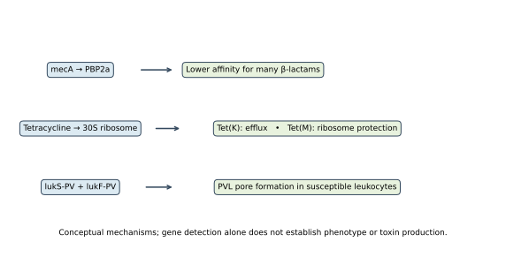
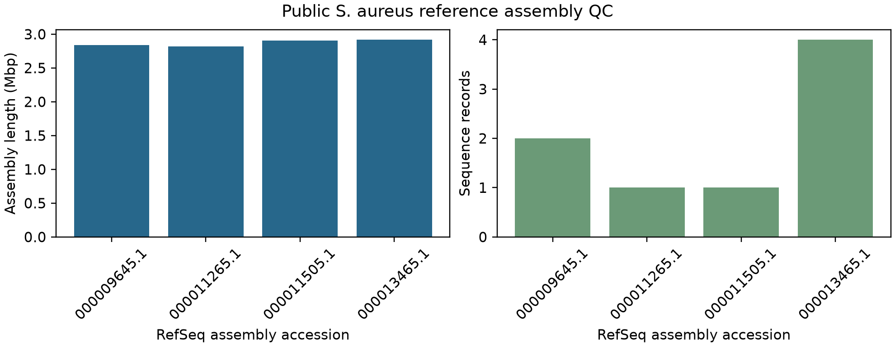
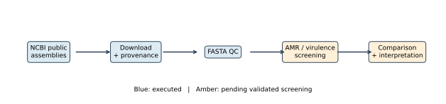

# Genomic Investigation of MRSA Virulence and Antimicrobial Resistance

**Tharuniya Anpalakan — Project Author**

This portfolio project examines what a reproducible analysis can establish about antimicrobial resistance and virulence markers in public *Staphylococcus aureus* genomes. It uses four versioned NCBI RefSeq reference assemblies. The assembly download and quality-control stages have been executed; gene screening is implemented but awaits AMRFinderPlus in a compatible environment. No wet-lab sequencing or susceptibility testing is claimed.

## Research question

**What antimicrobial resistance and virulence determinants can be identified in a reproducibly selected collection of publicly available *S. aureus* genomes, and how do their distributions vary across available isolate metadata?** Secondary questions cover `mecA`/`mecC`, tetracycline resistance, PVL-associated genes, other selected virulence factors and genotype–phenotype agreement where metadata permit. The present cohort lacks enough verified phenotype and epidemiological metadata for the last comparison.

## Why these markers matter

`mecA` commonly encodes PBP2a, which can sustain cell-wall cross-linking under many β-lactams. SCCmec is a mobile cassette, but its type requires cassette-level evidence. Tetracycline resistance can involve efflux or ribosomal protection. PVL requires both `lukS-PV` and `lukF-PV` genes for its bicomponent toxin; sequence calls do not show toxin production. See [scientific background](docs/scientific_background.md) and the linked literature there.



*Conceptual figure based on the cited scientific background; it is not a genomic result.*

## Dataset and completed results

The [manifest](data/metadata/genome_manifest.csv) fixes four distinct complete reference assemblies: N315 (`GCF_000009645.1`), MW2 (`GCF_000011265.1`), MRSA252 (`GCF_000011505.1`) and USA300_FPR3757 (`GCF_000013465.1`). Selection is a technical demonstration rather than representative sampling. The [selection rationale](docs/dataset_selection.md) links NCBI records and states missing metadata explicitly.

All **4/4 downloaded assemblies passed the predefined exploratory QC screen**. Lengths span 2,820,462–2,917,469 bp, and FASTA record counts span 1–4. These are observed assembly properties, not evidence of complete/contamination-free genomes. Details: [QC table](results/genome_qc.csv) and [QC figure](figures/genome_qc.png).



*Figure 1. Assembly length includes all FASTA records, including plasmid records where present. Source: NCBI RefSeq downloads on 17 October 2026; metrics calculated by `src.genome_qc`.*

## Analysis workflow



Download versioned assemblies → validate FASTA and calculate QC → run NCBI AMRFinderPlus with a versioned database → parse positive AMR/virulence calls → review hit quality and database coverage → compare only metadata-supported groups. The first two steps are complete. AMRFinderPlus, MLST, SCCmec and phenotype analysis remain pending. The [methods](docs/methodology.md) explain thresholds, result states and interpretation limits.

## Reproduce

From a fresh clone, create a Python environment and install `pip install -e .[dev]`. On Linux or a supported Conda environment, `conda env create -f environment.yml && conda activate mrsa-genomics` also installs AMRFinderPlus and MLST. On Windows, the Python QC and plotting stages work directly; use a Linux Conda environment for AMRFinderPlus. From the repository root:

```bash
python -m src.data_acquisition
python -m src.genome_qc
python -m src.visualization
python -m src.comparative_analysis
python -m src.statistical_analysis
pytest -q
```

After installing and updating AMRFinderPlus's database, run `python -m src.amr_analysis` and `python -m src.virulence_analysis`, then rerun comparative analysis. Record `amrfinder --version` and `amrfinder --database_version`. Inspect the native TSVs and database coverage before interpreting non-calls. The wrappers do not infer susceptibility or toxin activity.

## Results and limits

The executed result is assembly QC only. **No AMR or virulence gene findings, SCCmec types, sequence types, phenotypes or phylogenetic tree are reported.** The cohort is tiny and chosen from historic named strains; its marker frequencies would not estimate population prevalence. Metadata are incomplete. [Limitations](docs/limitations.md), [data provenance](docs/data_provenance.md), [source review](docs/source_review.md) and the [project audit](docs/project_audit.md) record the outstanding work. The detailed [LaTeX report](reports/mrsa_genomic_analysis.tex) and [compiled PDF](reports/mrsa_genomic_analysis.pdf) separate completed QC from pending analyses. Rebuild the PDF with `python reports/build_latex.py` after installing a LaTeX distribution with `pdflatex` and `bibtex`.

## Project map

`data/metadata/` contains the accession manifest; `src/` contains reusable acquisition, QC, analysis and plotting code; `notebooks/` contains guided executable views; `results/` contains observed QC outputs; `figures/` contains original schematics and the QC plot; `docs/` contains scientific context and audit; `reports/` contains editable report source and PDF. Raw genomes and the original coursework are excluded from Git.

## References

The report cites 18 sources, including the original [N315](https://pubmed.ncbi.nlm.nih.gov/11418146/), [MW2](https://pubmed.ncbi.nlm.nih.gov/12044378/), [MRSA252](https://pmc.ncbi.nlm.nih.gov/articles/PMC470752/) and [USA300](https://pubmed.ncbi.nlm.nih.gov/16517273/) genome publications; [SCCmec classification guidance](https://pubmed.ncbi.nlm.nih.gov/19721075/); [the PVL systematic review](https://pmc.ncbi.nlm.nih.gov/articles/PMC3530297/); and [AMRFinderPlus methodology](https://pmc.ncbi.nlm.nih.gov/articles/PMC8208984/). The full, editable reference list is in [bibliography.bib](references/bibliography.bib).

## Author

Tharuniya Anpalakan. This is an independent computational portfolio project using public bacterial genomes; it is not a peer-reviewed publication or institutional endorsement.
